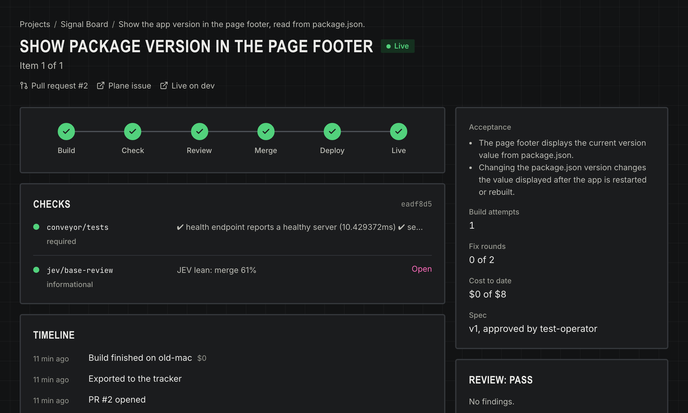

Conveyor is the bit between having an idea and seeing a working change. Describe what you want, work through a spec with a chat agent, approve it, and send the work to a coding agent on one of your machines. The system then carries that change through tests, review, merge and a dev deployment.

The useful part is keeping that work visible. A command running somewhere is only one step. The console also needs to show what needs a decision and where a change has stopped.

## A control plane and workers

The current version separates the web console from the server that records and dispatches work. Workers run on the machines doing the builds. Model adapters and service bridges sit behind their own packages, so the workflow is not tied to one coding agent or one git host.

This is the current source layout, shortened from the repository documentation:

```text
apps/console       React + Vite console
apps/server        ledger, API and dispatcher
packages/core      commands, events and state
packages/worker    work on each machine
packages/models    coding-agent and model adapters
packages/bridges   git hosts, tickets and deployment
```

Keeping commands and state in the core makes the workflow something that can be reasoned about separately from the UI. The console is a view onto the work rather than the only place the work exists.

## What I would show in a walkthrough

Follow one small change from the initial idea through spec approval, the worker run, the resulting diff and the dev deployment. The interesting screens are the places where the operator needs to intervene: an unclear spec, blocked access or a review that needs another pass.

The source and running service are private. This write-up is the public-facing place for a walkthrough and selected implementation details; it does not require access to the homelab.
