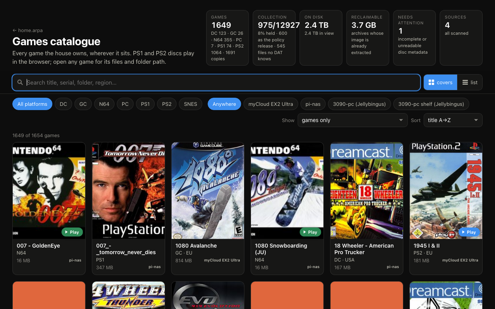

The games library is spread across NAS storage and PCs. HomeLab Games turns those separate folders into one searchable catalogue, with platform details, cover art and the location of each copy.

The scanner writes one JSON fragment per source. The browser loads and combines them. That keeps the catalogue independent of a central database and lets each machine contribute its own inventory.

## A missing mount must not erase the library

A storage source can be temporarily unavailable. Treating that as an empty folder would publish a misleading catalogue. This excerpt from `scan_games.py` catches the missing root before scanning:

```python
def scan_source(src: dict) -> dict | None:
    root = src["root"]
    if not os.path.isdir(root):
        print(f"[{src['id']}] root missing: {root}", file=sys.stderr)
        return None
```

The scanner leaves the previous fragment in place when the source is missing. It also rejects an unexpectedly empty scan. An old inventory is more useful than silently claiming that everything vanished.

## Browser play builds on existing emulators

The project supplies the catalogue, scanning, file delivery and player integration. EmulatorJS handles supported PS1, SNES and N64 games; the Play! WebAssembly core handles PS2. The emulator engines are third-party projects.

Large images make progress reporting matter. The player reports the real transfer stages and sizes instead of showing a made-up loading timer. Browser saves also need to survive closing and reopening the browser.

## What makes a good demo

Search for a title available on two machines, inspect the source locations, then launch a supported game from an owned library. Follow that with a missing-storage example. That tells the story of the system better than a cover grid on its own.
