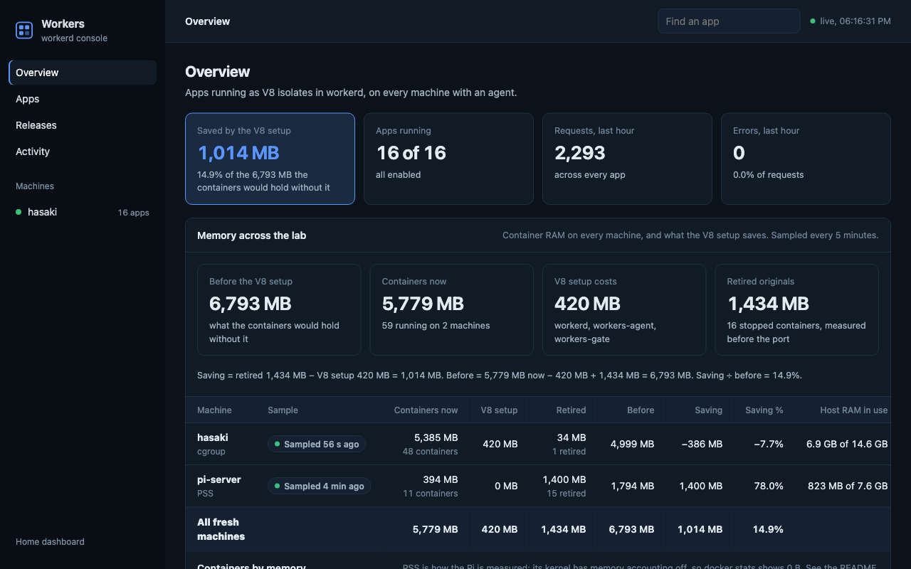

Running a collection of small apps raises the same questions repeatedly: how is an app deployed, what can it access, where does its state live, and how do I undo a bad release?

The HomeLab application platform brings those operations into one manager and console. It runs applications in isolated V8 instances (V8 isolates), using Cloudflare's workerd runtime. I built the management and deployment layer, not the JavaScript runtime itself.

## Describe an app and its capabilities

Each app has a `worker.json` describing its entry module, compatibility date and bindings. The manager generates the runtime configuration from those declarations.

Here is a reduced example of the manifest shape, with a generic app name and no private endpoints:

```json
{
  "name": "example",
  "main": "index.js",
  "compatibilityDate": "2026-09-01",
  "port": 8002,
  "bindings": {}
}
```

Bindings make access an explicit part of an app's declaration. The surrounding platform handles releases, runtime configuration and the operational view in the console.

## Validate before replacing the running configuration

A shared runtime creates a shared failure mode: a configuration it cannot load can affect several apps. The manager first starts a candidate configuration in a throwaway runtime on spare ports. Only then does it replace the active configuration and check the new generation and app responses.

If those checks fail, it restores the previous configuration. That rollback path belongs in the normal deployment flow, rather than in an emergency note that nobody has tried.

## Show one app moving through the system

A good walkthrough would deploy a harmless change, inspect its bindings and logs, and select the previous release. The article should also show an invalid configuration being rejected before it reaches the active runtime. That is the piece of engineering worth making visible.
