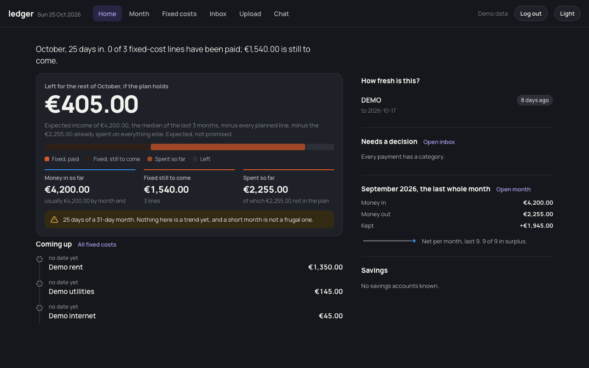

*The screenshot uses synthetic demo data, not real household transactions or balances.*



Ledger brings household transactions into one application for imports, reconciliation and spending analysis. The interface is a Django app, and the underlying data includes both transactions and uploaded statements.

A finance application is useful only if the records can be checked. Importing a statement is the beginning of the work: transactions still need to be reconciled, and the analysis should lead back to the records it summarises.

## Encrypt the statements too

The storage decision covers the SQLite database and uploaded PDFs together on an encrypted volume. Statements can contain as much sensitive information as the parsed transactions. Encrypting only the database would leave a second copy of that information outside the boundary.

The unlock key is kept off the machine hosting the data. The repository exposes a small operational interface for opening and closing the volume:

```bash
crypt/unlock.sh
crypt/unlock.sh lock
```

Those are commands from the repository, rather than a complete installation recipe. The implementation and private connection settings stay out of this post.

## Recovery is part of the application

An encrypted backup needs a restore path. The project documentation records a restore drill alongside the encrypted backups. That is a more useful milestone than simply having an archive file somewhere.

There is a deliberate availability tradeoff too: the host has a sleep schedule. This is a household tool used during the day, so continuous availability is not the only objective.

## Showing it without publishing household data

A public tour needs a synthetic statement and synthetic transactions. The screens should demonstrate import, reconciliation and analysis without exposing real balances, account identifiers or merchant history. The screenshot in this draft uses synthetic transactions in the real application; it does not show the household's finances.
