*The video above walks through every part of the app in under seven minutes. This post covers the same ground in text. The code and the builds for Mac, Windows and Linux are on [GitHub](https://github.com/joe-lloyd/neon-video-studio).*

This is Neon Video Studio. It's a desktop video editor I built, and every button in it is also a command, so an agent can edit a video while I watch.

I wanted one tool for cutting videos without bouncing between apps, and one that an agent could run from start to finish.

Under the hood, a Bun process owns the project. The window is React. Frames come from Neon's own engine, `@neon/motion`, which draws the preview and the export the same way. Yjs keeps every copy of the project in sync.

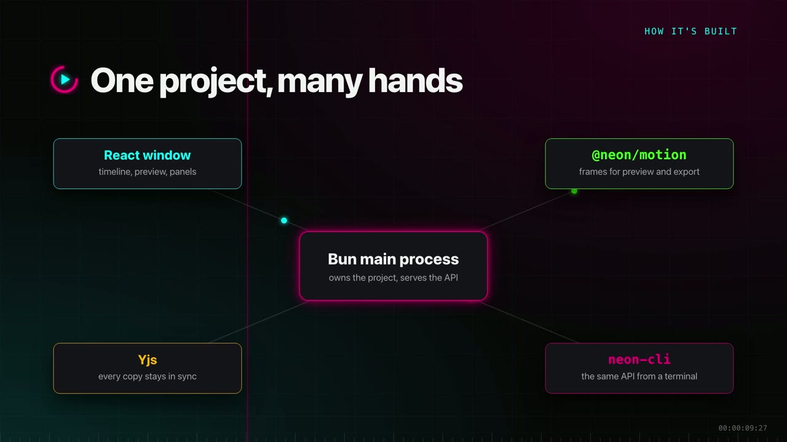

## Projects

Projects open from an overview. Each project is a folder with its media inside, so you can copy it to another machine and open it there.

A new project takes a name, a format and a frame rate. Vertical and square formats are there for shorts.

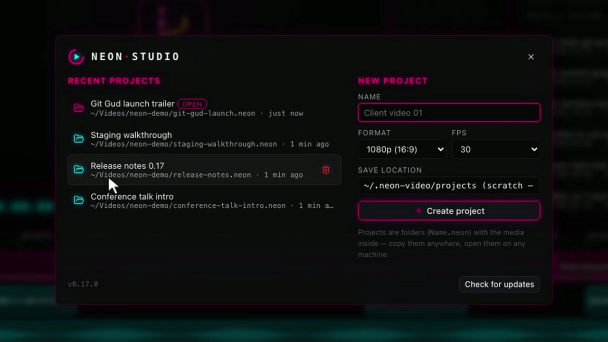

## Editing the timeline

The timeline has video, audio and FX tracks. Clips draw their waveform, so you can see where someone is talking.

- Drag a clip to move it. It snaps to the playhead and to the edges of other clips.
- Drag an edge to trim. Trimming the start slides into the footage.
- **S** splits whatever sits under the playhead.
- **Add at playhead** puts media in the first free spot on the track, so it never lands on top of another clip.
- **?** lists every shortcut.

Undo takes back only your own edits. That matters once an agent or another person is editing the same project.

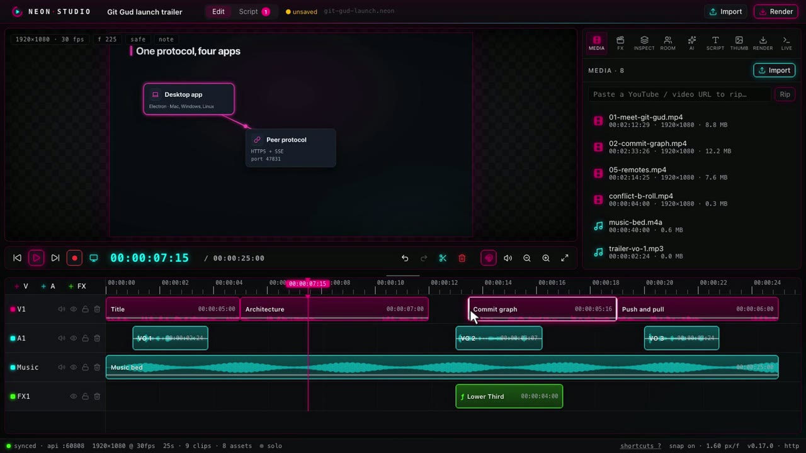

## Templates and the inspector

Titles, lower thirds and captions are React components. They sit on FX tracks like any other clip. Each card in the FX panel is a live preview, and clicking one drops it at the playhead.

The inspector builds its fields from the component's schema. Change the text and the preview follows. You can drag an element on the canvas too, and it snaps to the centre and the thirds. Every element can animate in and out with a fade, a slide or a pop.

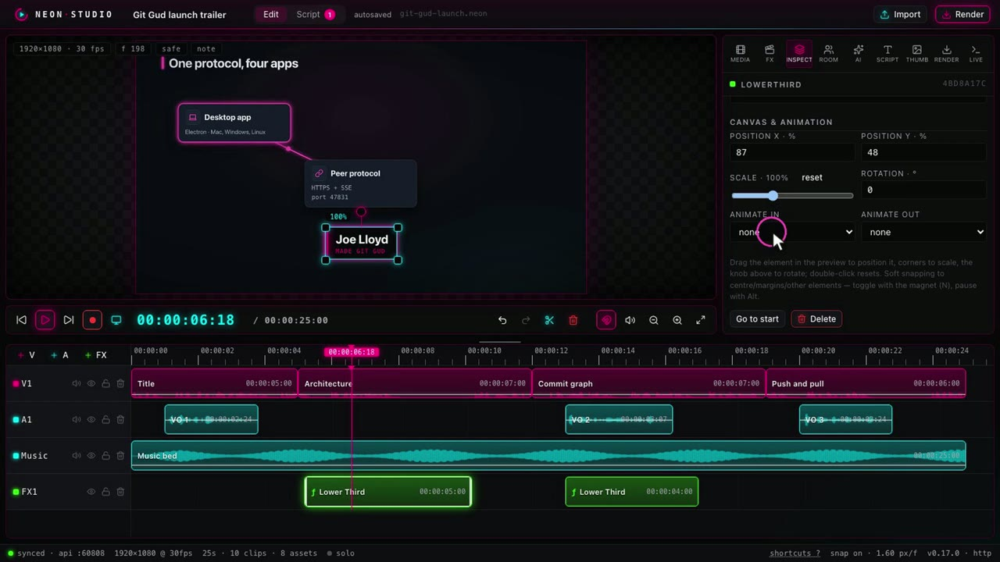

## FX packs

When the built-in set isn't enough, you write an FX pack. It's a folder with a `pack.json` that describes every field, and an `index.tsx` with the components. Any npm library works inside it.

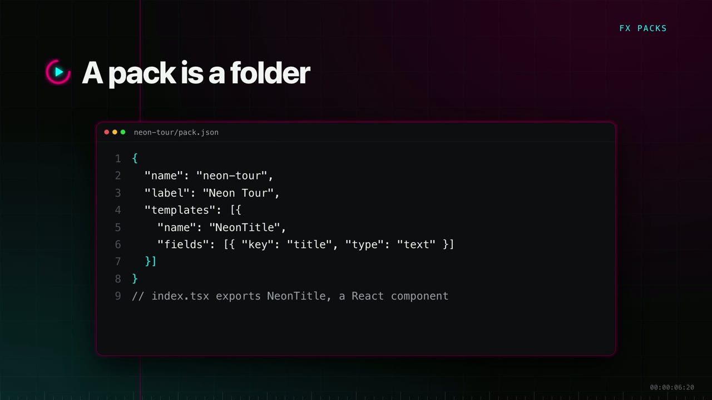

The Library lists the packs on this machine. **Install folder** adds one, and so does `neon-cli packs install`. Its components show up straight away, with previews. The titles and diagrams in the video come from a pack made for it, in Neon's colours.

A project keeps a copy of every pack it uses, so it still renders on a machine that never installed them.

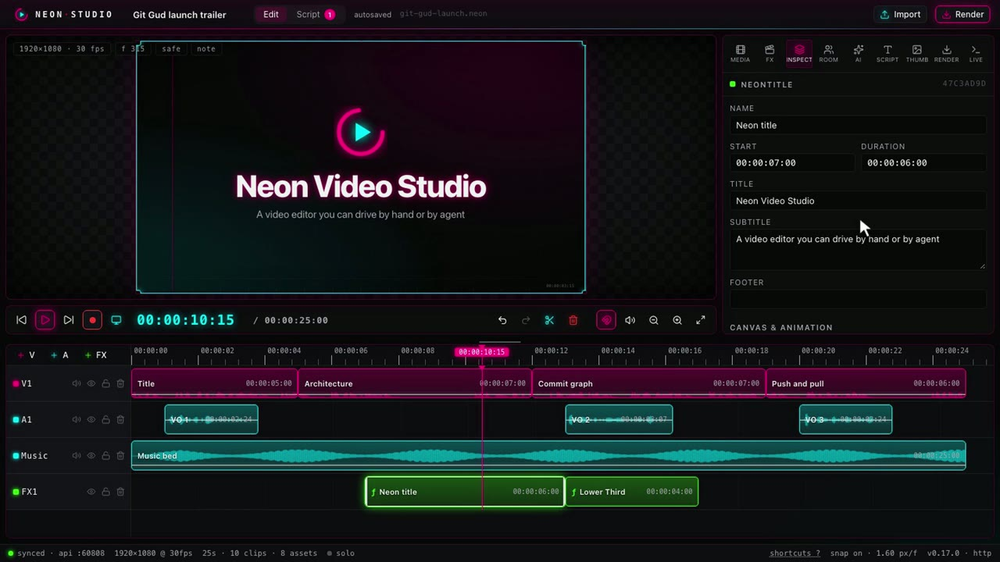

## Script and prompter

My videos start as a script. The Script view holds sections of lines, each with what I say and what the picture shows.

A section is a draft, waiting on me, or approved. Notes pin to a line, and an agent reads and answers them from the CLI.

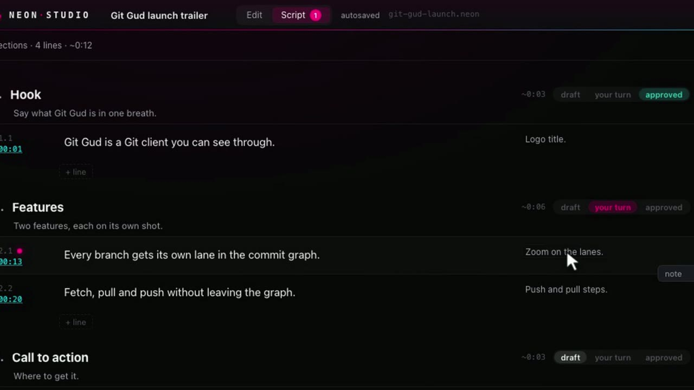

In the editor, the prompter shows the line under the playhead. **Record line** counts you in, plays that stretch of the timeline and records just that line. The new take replaces the old one only once it has saved.

## Screen demos and AI

For screen demos, the screen button records the display and your microphone into one file.

The AI panel runs local engines and shows which ones this machine has: ffmpeg, Apple Vision, yt-dlp and whisper.cpp. Nothing leaves the machine.

- **Silence trimming** needs no model. It finds the pauses and shortens each one, and the cuts land as normal edits you can undo.
- **Enhance** gives a clearer voice at broadcast loudness. It writes a new file and keeps the original in the media library.
- **Filler removal** and **text-driven editing** need whisper.cpp. The panel cuts the ums, and the transcript becomes an editor: select words, press delete, and they're gone from the video.
- **Zooms** ease in on the part that matters, and stay on that moment through later cuts.

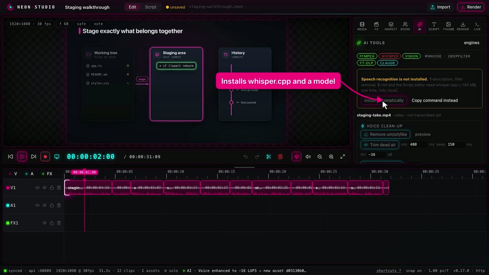

## Thumbnails

The Thumb tab builds the YouTube thumbnail from the same components. The background is a frame of the timeline or a colour, and layers stack on top. `neon-cli thumbnail` builds the same thing from a script, which is how this video got its thumbnail.

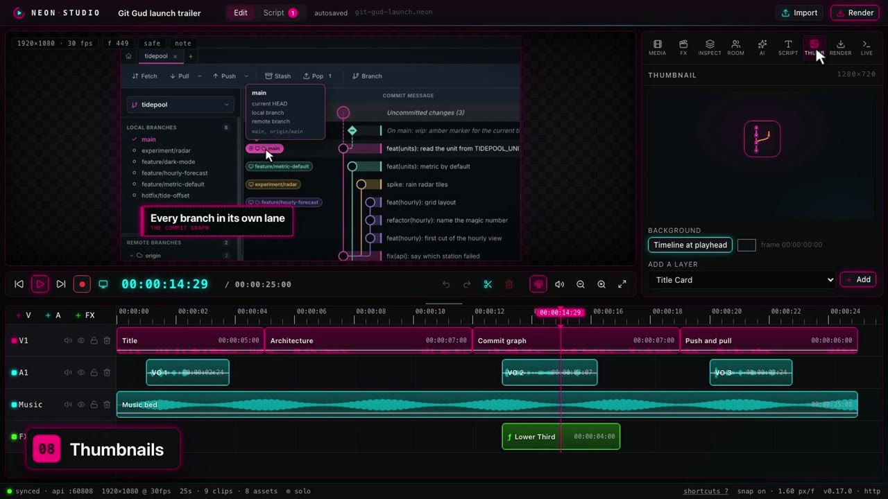

## Render and publish

Render exports an H.264 MP4 through the same engine as the preview. Presets run from a quick draft up to 4K, vertical and square. The render runs in a separate worker, so you can keep editing while it goes.

Once you sign in with Google, the same panel uploads to YouTube with the title, description, tags, visibility, a schedule and the project thumbnail.

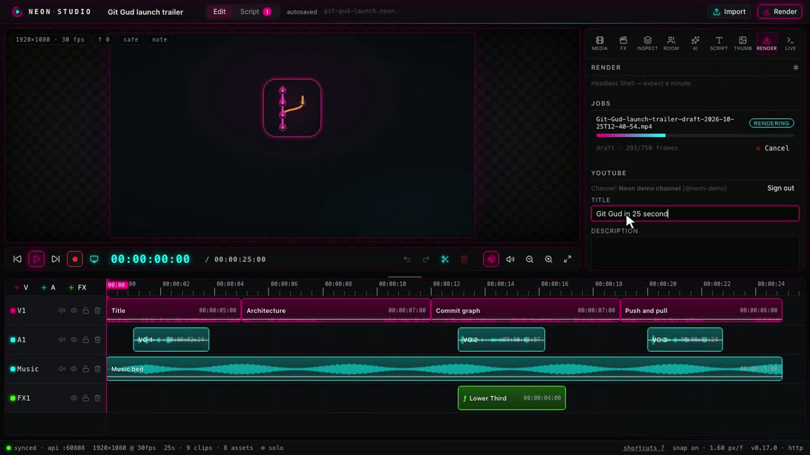

## Driving it from the CLI

Everything above is also a command. `neon-cli` talks to the running app over a local API, and every change it makes shows up live in the window.

```sh
neon-cli timeline                                   # the edit as text, with every clip id
neon-cli timeline insert --component LowerThird --props '{"title":"Every branch in its own lane"}'
neon-cli apply plan.json                            # many edits as one undo step
neon-cli still --at 12s --out frame.png             # look at a frame before rendering
```

The lower third lands on the timeline and the Live panel logs it as a CLI edit. A plan file runs every step as one undo step, or rolls the lot back if one fails. The still command lets an agent look at its own work before it renders.

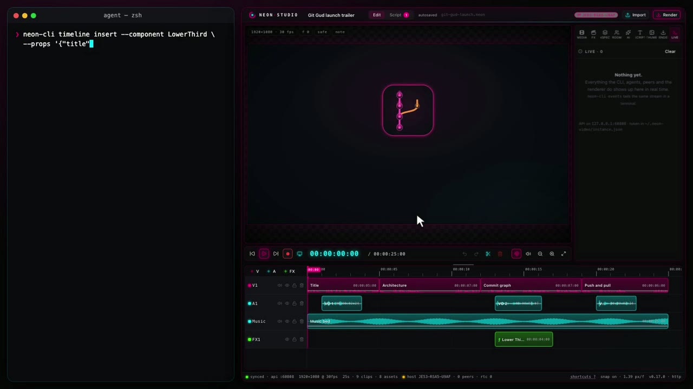

## Editing together

Rooms put two people on one project. One machine hosts and the other joins with the room code. There's no server in the middle. Edits from either side show up on both, and each person can see where the other one's playhead is.

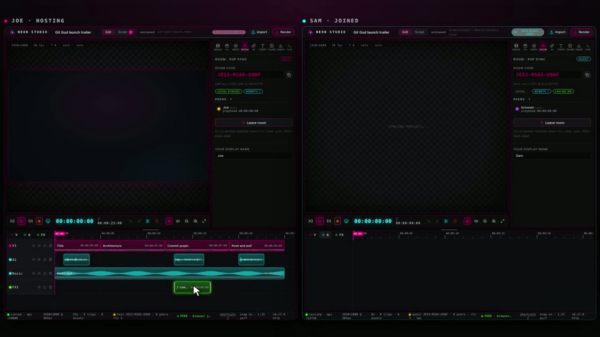

## How the video was made

The video went down the same path. An agent wrote the script, and Kokoro read it on this machine. A script drove the app in a browser and recorded each take. Then `neon-cli` built the edit with its chapters, zooms and thumbnail, and rendered it.

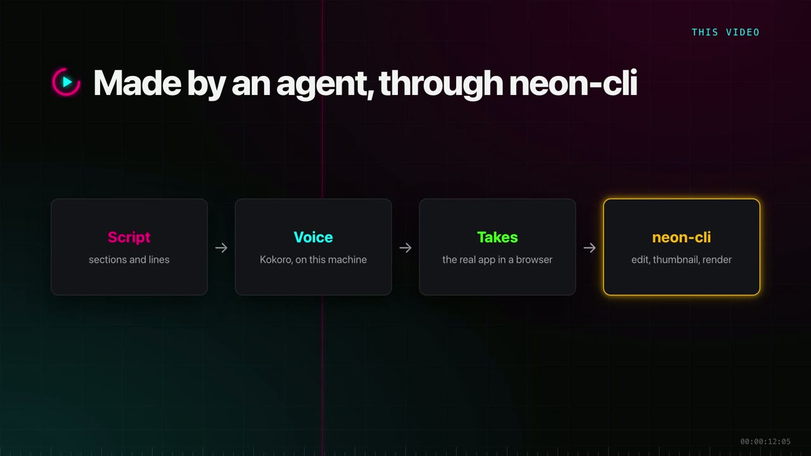

The same pipeline made the [STFU tour](/stfu-tour).
