*The video above walks through every feature in eight minutes. This post says the same things, with the details you can't see on screen. Try it at [open-chinese.joe-lloyd.com](https://open-chinese.joe-lloyd.com).*

This is Open Chinese. I built it because I wanted one place to learn Mandarin vocabulary and then actually read it.

It has three parts that feed each other:

- A spaced repetition scheduler for vocabulary
- Graded stories written for every HSK level
- A dashboard that shows how it's all going

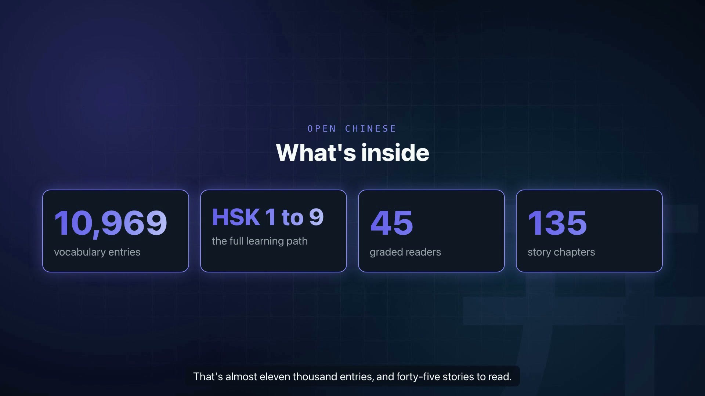

The word list covers the whole HSK, levels 1 to 9. That's 10,969 entries, plus 45 stories with 135 chapters between them.

## The website

The home page sums it up: study what is due, then read something real.

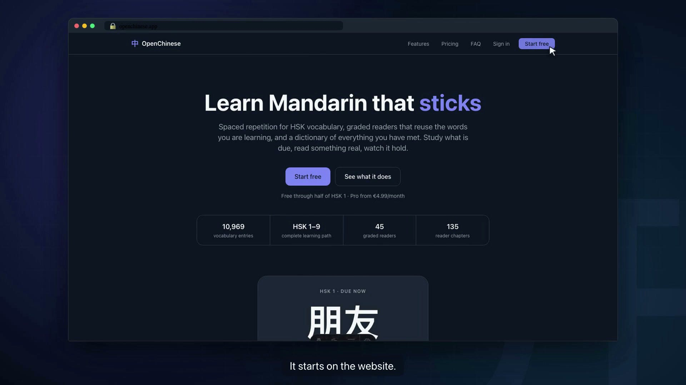

The features page also lists what the app deliberately doesn't do. It won't grade your tones, teach grammar, or turn study into a game.

The first half of HSK 1 is free. Pro unlocks every level and every story. Sign-in is Google only, so there's no password to invent.

## The dashboard

After signing in you land on the dashboard. The learner in the video has been studying for about two months.

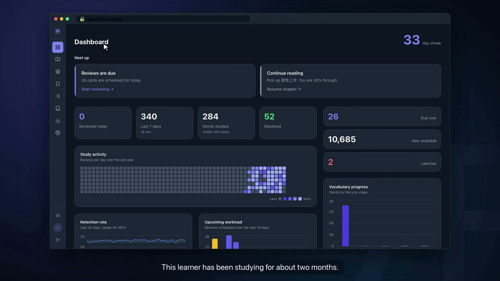

- **Streak**, top right.
- **Next up** suggests what to do now: clear due reviews, pick up the story you were reading, or deal with leeches.
- **Tiles** count today's reviews, the last seven days, every word you've studied and the ones you've mastered.
- **Study activity** is a year of reviews, one square per day.
- **Retention rate** shows how often you remembered over the last 30 days, against a target of 85 to 90 percent.
- **Upcoming workload** shows the next 14 days of reviews, so a heavy day never surprises you.
- **Vocabulary progress**, **Accuracy by skill** and **HSK progress** show where every word sits, how you do on pronunciation versus meaning, and how far through each level you are.

Leeches are words you keep failing: nine reviews in a row where you missed both skills. You can reset a leech, suspend it or delete it.

## How the scheduler works

Every word tests two skills. First you see the characters and ask yourself how to say them. Then you check whether you know what they mean. You grade each step honestly: *I knew it*, or *I didn't*.

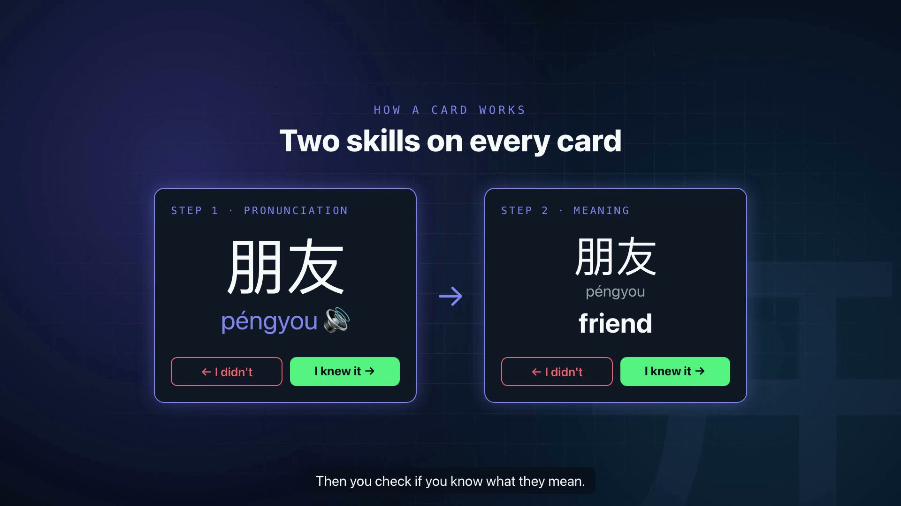

Each skill keeps its own interval. Say you get the pronunciation right, reveal the meaning, and find you'd forgotten it. The word comes back tomorrow, and its pronunciation interval keeps growing. Missing the pronunciation, or answering *I don't know* to the meaning before you reveal it, ends the card there and counts as a miss on both skills.

Remember a word and the gap before you see it again grows: 1 day, then 4, then 10, then about two months, then about a year.

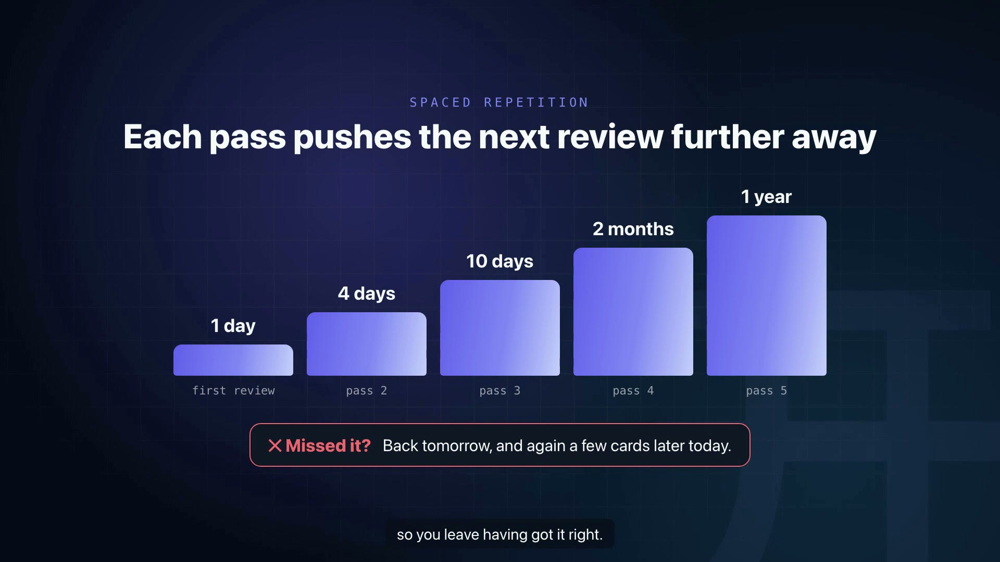

Miss it, and it comes back tomorrow. It also comes round again a few cards later in the same session, so you get another go before you finish. That retry is practice, not a second review, so it doesn't move the schedule.

As the gaps grow, a word moves up through the statuses: Weak, Strong, Memorized and finally Mastered.

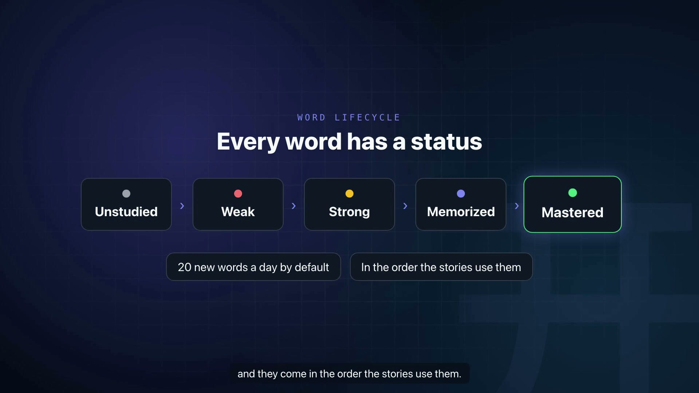

New words arrive at a steady pace, 20 a day by default. They come in the order the stories use them, so the first words you learn are the ones the first story needs.

## A study session

**Start reviewing** opens a session. You see the word, think of how to say it, then reveal the answer. The pinyin appears and the word plays out loud.

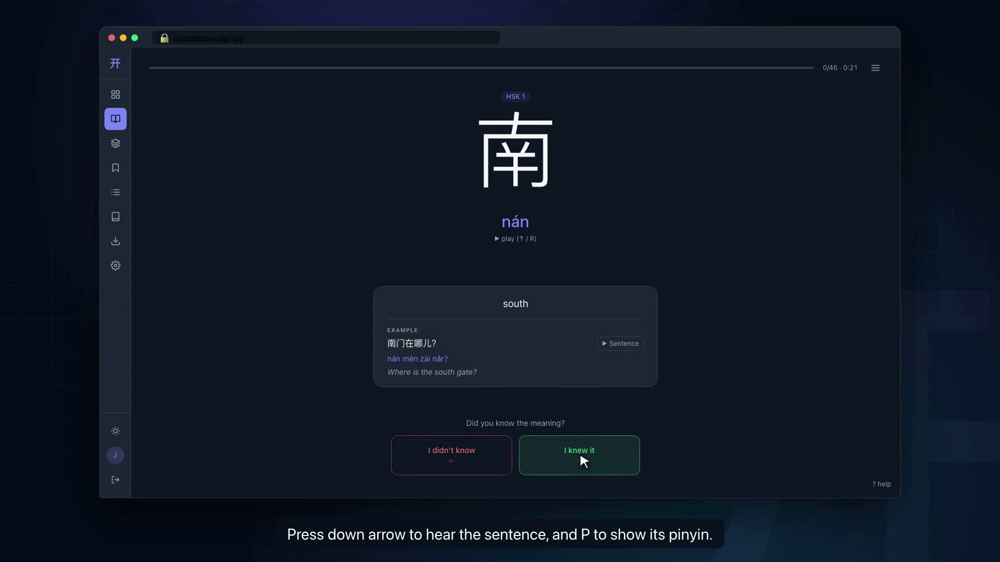

Then the meaning. Reveal it and you get the definition with an example sentence.

Every button has a key, so a whole session runs from the keyboard:

- **Space** or **→** reveals the answer
- **→** answers *I knew it*
- **←** answers *I didn't know*
- **↑** or **R** replays the word
- **↓** plays the example sentence
- **P** shows the example's pinyin
- **?** shows every shortcut

When you finish, the summary shows how many cards you did, how long it took and your accuracy on each skill. **Keep going** starts another round.

## Other ways to study

When nothing is due, you get the session picker:

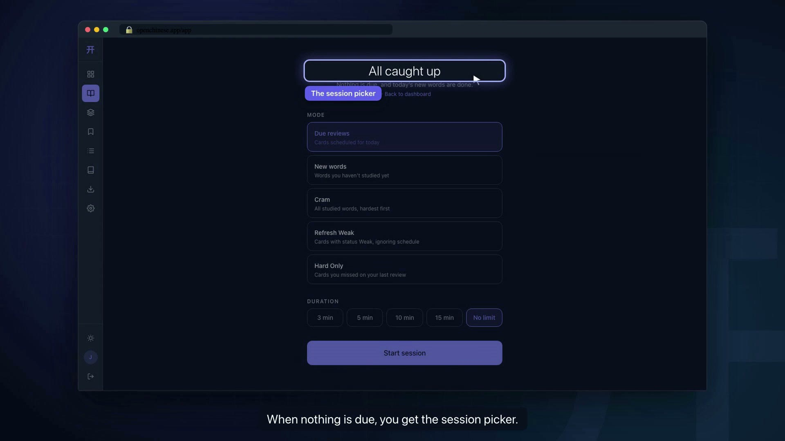

- **Due reviews** is the normal mode.
- **New words** introduces fresh vocabulary, past the daily limit if you want.
- **Cram** runs through every word in your dictionary, hardest first, due or not.
- **Refresh Weak** drills the words still marked Weak.
- **Hard Only** replays the ones you missed last time.

You can cap a session at 3, 5, 10 or 15 minutes, for when you only have a moment.

## HSK levels

The HSK page lays out all nine levels. Each card shows how much of the level you've studied and how many of its words are due. **Study HSK 1** starts a session for that level.

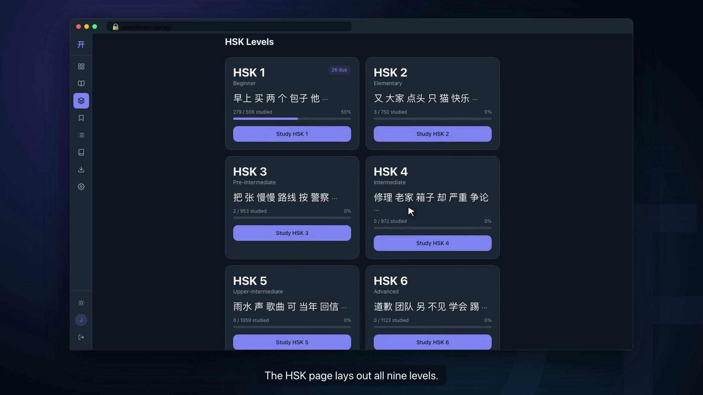

## Graded readers

This is the part that makes the words stick. The library holds 45 stories, five for each HSK level, three chapters each. Read them in order and each one builds on the last.

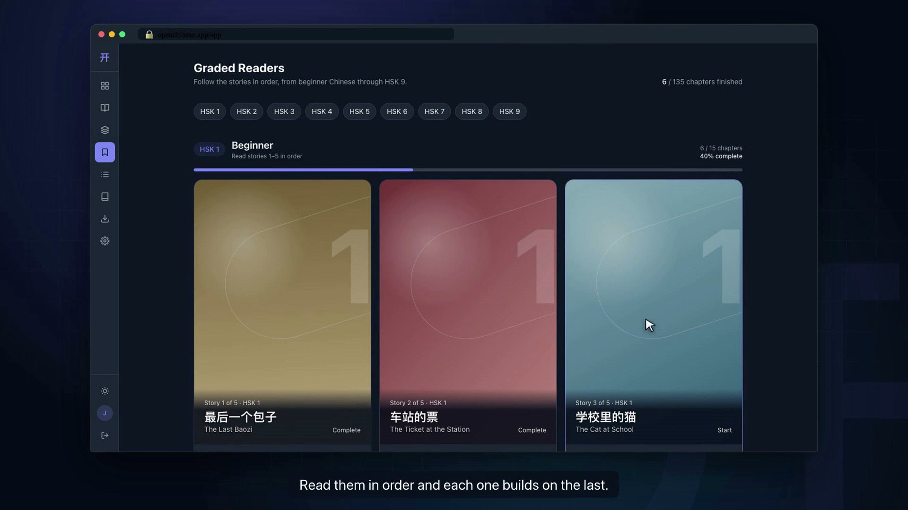

Each chapter is written to its level. In HSK 1 and 2, a chapter uses at most two words above the level, and each of its focus words appears at least three times.

Inside a chapter:

- Words you haven't met yet are highlighted, so you know what's coming.
- Tap any word to see its pinyin and meaning.
- **Pinyin** puts pinyin above every word. **English** shows a translation under each paragraph.
- **Read chapter** plays the whole chapter aloud in Mandarin.
- **Follow words** lights up each word as it's spoken.
- **Play from here** starts the audio from any word you tap.

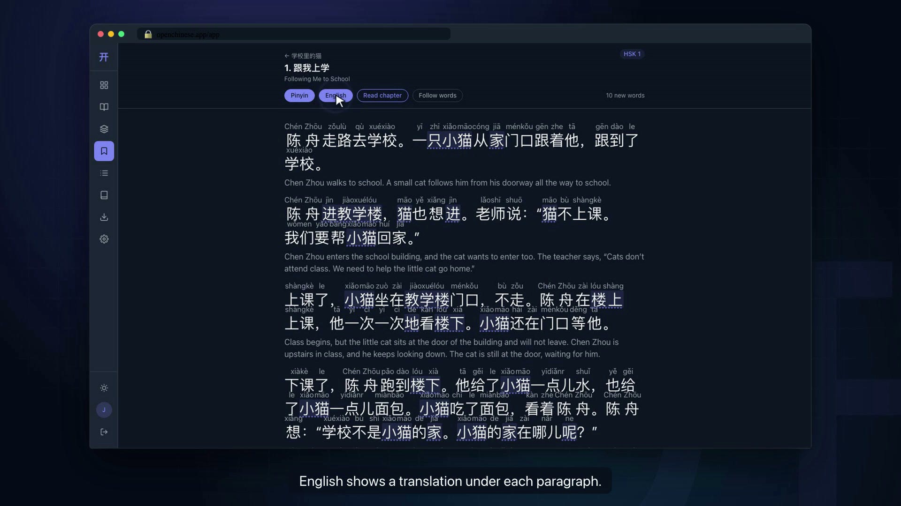

When you're done, **Mark as finished**. The chapter's new words go straight into your dictionary.

That closes the loop. When new words come in, the ones you met in a story come first. So by the time you reach the next story, more of it already makes sense.

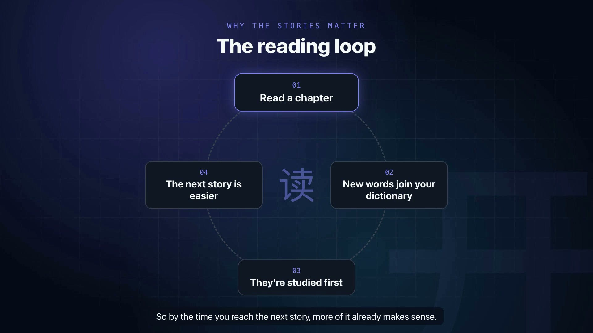

## The dictionary

The dictionary holds every word you've met. Filter it by status, level or deck, and sort it however you like.

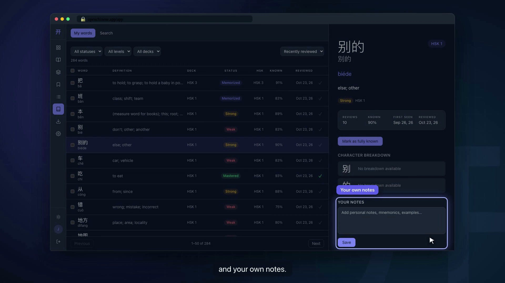

Open a word for its full entry: the definition, an example sentence you can play, a breakdown of each character and your own notes. Already know a word? Mark it as known and it won't be scheduled.

Search covers all 10,969 entries. Type English, pinyin without tones or characters: *friend*, *pengyou* and 朋友 all find the same word.

## Queue and import

The queue manager is for your decks. Drag them to set which one gets priority, and pick a study mode for each. Open a deck to see its words and mark any you already know.

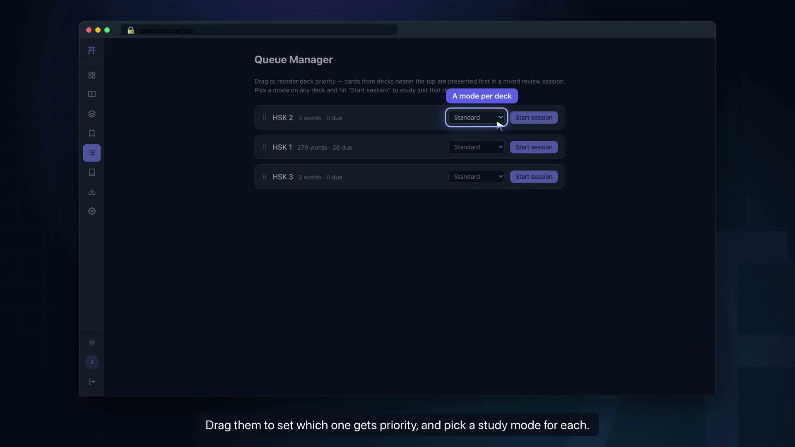

Coming from Hack Chinese? Export your words as a CSV and drop it on the import page. It needs these columns:

```
Simplified, Pinyin, Definitions, List Name, Status, Next Review
```

You get a preview first, with a count of each status. Confirm, and every word arrives with its status and next review date, in a deck named after its list.

## Settings

Choose how many new words you get each day: 5, 10, 15, 20 or 30. Pick a light or dark theme, or follow your system. The speech rate slider sets how fast words are read aloud. Pitch only changes the browser voice used when a word has no recording.

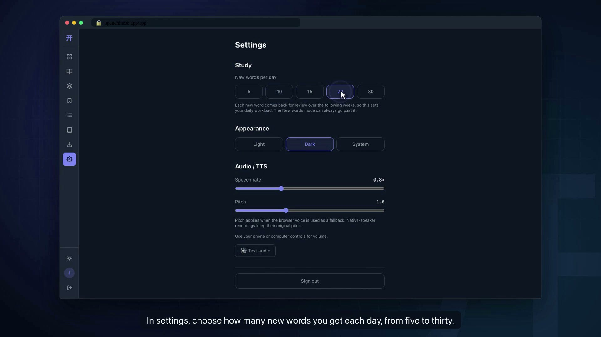

## On your phone

Everything works on a phone too. The menu button opens a drawer with every page in it. Study cards fit the screen with big buttons for your thumbs, and the stories read well on a small screen. Tap a word and its meaning pops up right where you are.

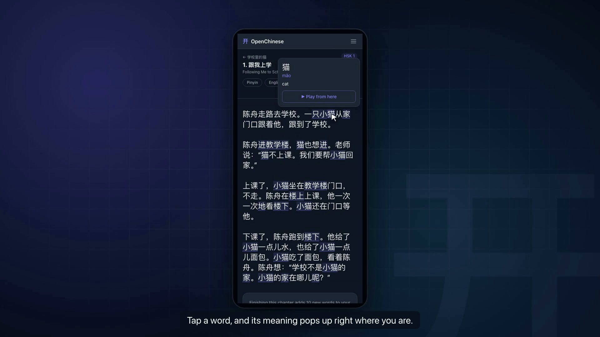

## Why there's no pronunciation check

An earlier version had a **Hold to speak** button that listened to you say the word. I took it out.

It used the browser's speech recognition, which returns characters and never tones. A Mandarin recognizer also quietly repairs tone mistakes, so saying the right word with the wrong tone usually came back as a match. A check that can't hear the part of pronunciation that matters most gives you confidence you haven't earned. So now nothing listens to you speak: you recall the pronunciation, hear the word read aloud and grade yourself.

## A daily routine

Here's the routine I use:

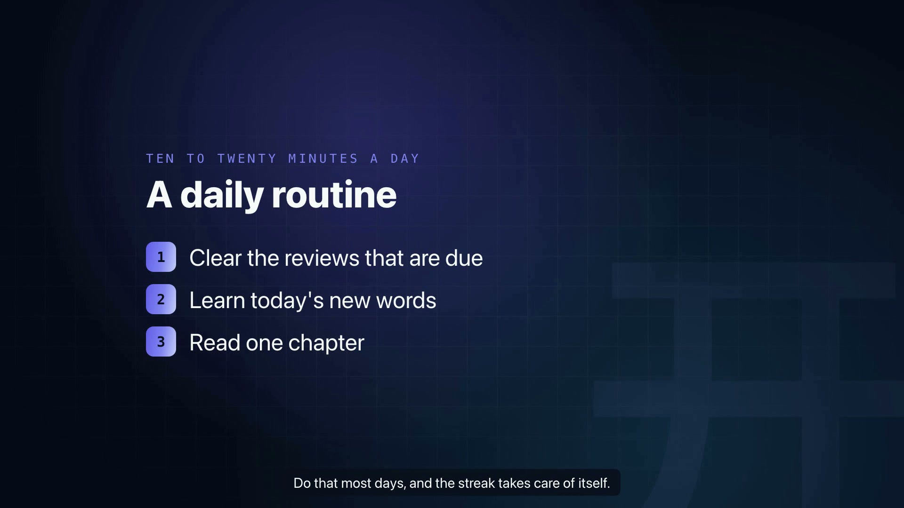

That's ten to twenty minutes. Do it most days and the streak takes care of itself.
