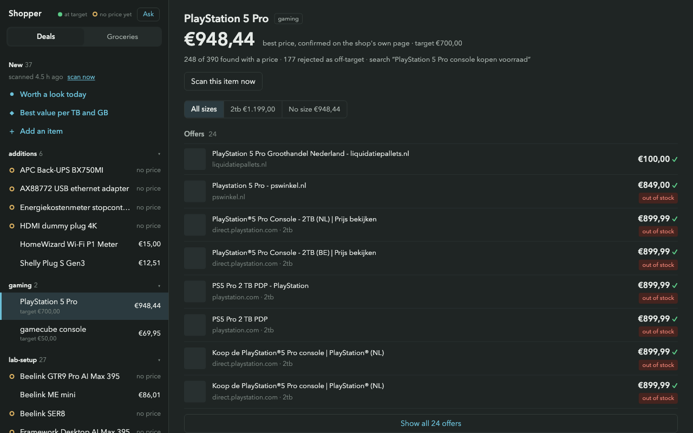

Shopper takes a watchlist, searches across retailers and records candidate offers. It tracks prices and sends notifications when an offer meets the watchlist's criteria.

The difficult part is deciding whether a search result is actually useful. A result might describe a different capacity, an expired promotion or a page that no longer exists. The search snippet is a lead to investigate, not a price to trust.

## Open the page before calling it a deal

The project documentation describes the change from trusting snippets to opening the retailer's page. Product identity, page liveness and the current price all matter before a notification is justified.

This is an illustrative outline of that decision, rather than a copied function from the application:

```typescript
if (!page.isLive) return;
if (!matchesWatchlist(page.product, watch)) return;
if (!page.hasVerifiedPrice) return;

recordOffer(page);
if (meetsAlertRule(page, watch)) notify(page);
```

The actual implementation also has to cope with different retailers, structured data, VAT and pages that do not expose a dependable price. Rejecting an uncertain offer is sometimes the right result.

## Keep the history

A single price is less useful without context. Recording offers makes it possible to compare a current result with earlier ones and avoid presenting the same discovery as something new every time the scanner runs.

The project also includes second-hand discovery and grocery comparisons. Those deserve their own examples because identity and comparison rules change across product types.

## A useful walkthrough

Use a synthetic watchlist to compare a valid offer, a different product and an expired listing. Show why each passed or failed, then follow the valid one into the price history and alert. That makes the validation work visible without sharing private shopping data.
