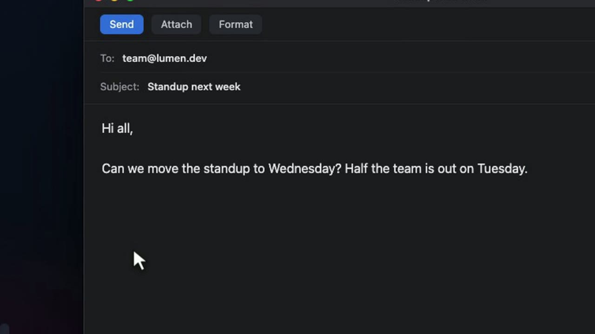
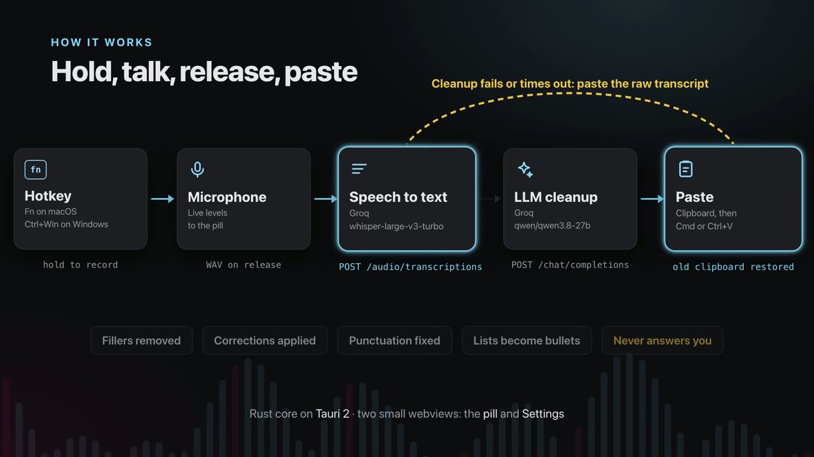
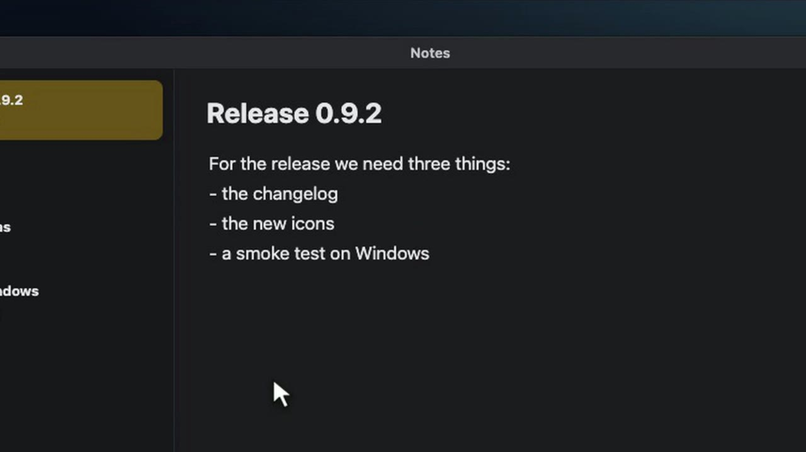
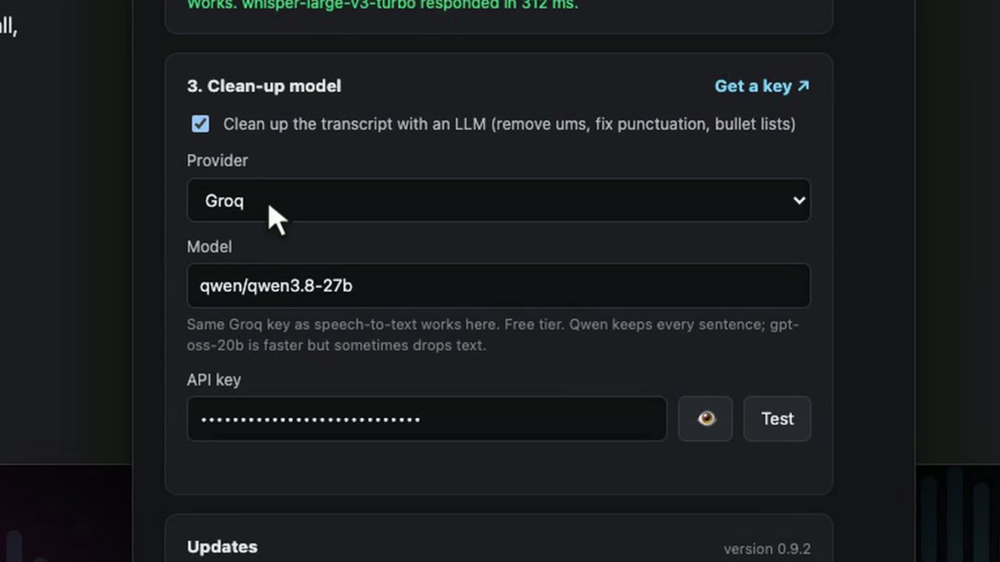
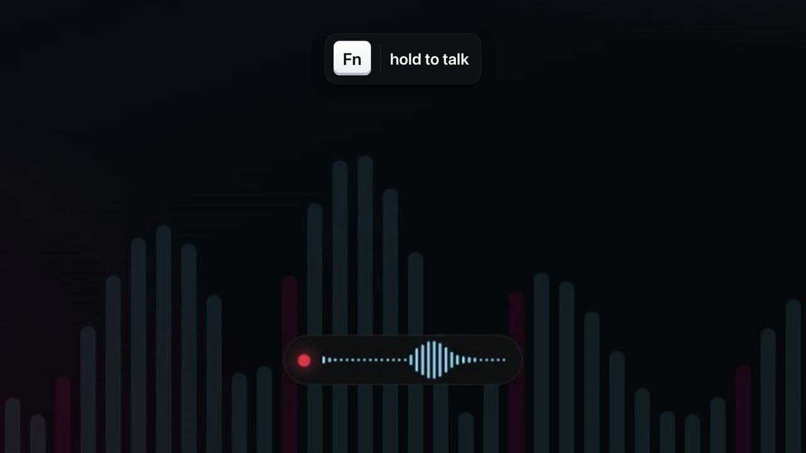
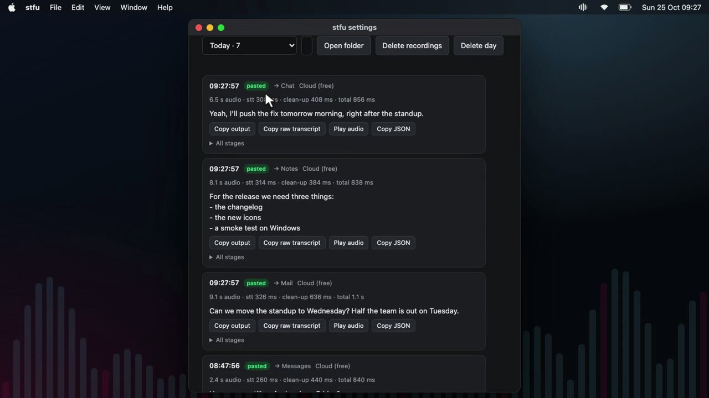
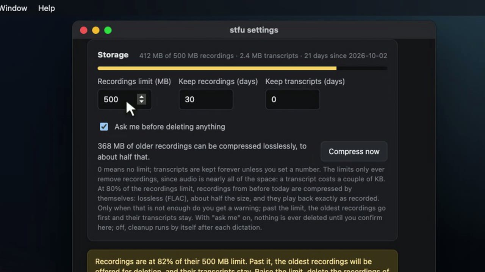
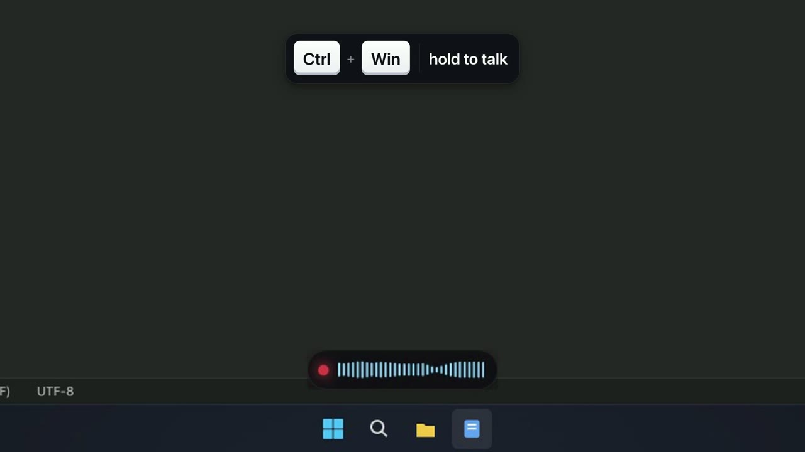
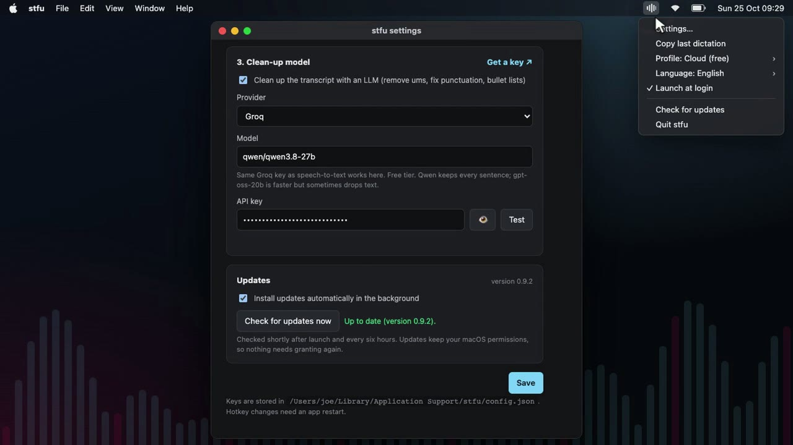

*The video above shows every feature in under seven minutes. This post covers the same ground in text. The code and the installers are on [GitHub](https://github.com/joe-lloyd/stfu).*

This is STFU. You hold a key, talk, and let go. A moment later, clean text lands wherever your cursor is.

I built it because I talk faster than I type, and the dictation I tried kept every um and every false start in the text.

## Hold a key and talk

In the video I'm writing to the team. I click into the email, hold **Fn** and say it, ums and all, changing my mind about the day halfway through.

What lands in the email has the ums gone, the correction from Tuesday to Wednesday applied, and the punctuation fixed. It takes about a second.



## How it works

```
hold hotkey -> record mic -> release -> speech-to-text -> LLM cleanup -> paste into the focused app
```

Holding the hotkey starts the microphone. A small pill at the bottom of the screen shows a live waveform, so you know it's listening.

When you let go, the recording goes to a speech to text model. Any OpenAI compatible `/audio/transcriptions` endpoint works. The default is Whisper large v3 turbo on Groq.

The raw transcript then goes to a language model with one job: clean it up. It removes fillers, applies corrections, fixes punctuation and turns spoken lists into bullets. It never answers what you said.

Then STFU puts the text on the clipboard, presses paste in the app you were using, and puts your old clipboard back.

If the cleanup call fails or times out, the raw transcript is pasted instead, so a dictation is never lost.

The core is Rust on Tauri 2. The pill and the settings window are two small web views.



## Lists and corrections

Lists are where it saves me the most typing. Planning a release in my notes, I said three things in one breath, and they came out as a bulleted list.



It works in any app that accepts a paste. In a chat reply I changed my mind halfway through, and only the final answer was kept.

## Providers and settings

Everything else lives in Settings, which opens from the icon in the menu bar.

On a Mac it needs three permissions: microphone, input monitoring and accessibility. If one is missing, its row turns red, with a button that opens the right page in System Settings.

Speech to text comes next. Groq is the default, because one free Groq key covers both steps. OpenAI works too, and so do whisper.cpp and Speaches on your own machine. Paste a key and press **Test**. It sends a short silent clip, so you know the key works before you rely on it.

The cleanup model has its own provider. The default is a Qwen model on Groq's free tier.



- **OpenCode Zen** gives you every model OpenCode hosts through one account. **Connect OpenCode** reuses the key from OpenCode's command line tool and lists the models live, free ones first. If the key is wrong or has expired, it says so instead of showing an empty list.
- **Ollama** is for anything private. Nothing leaves the machine, and Settings shows whether Ollama is running and which models you've pulled.

A profile holds a whole set of providers. I keep a cloud profile for speed and a local one for anything sensitive, and switch between them in Settings or from the menu bar.

## Nowhere to paste

Sometimes nothing has focus and there's nowhere to paste. Instead of losing the words, STFU leaves them on the clipboard and says so in the pill. You can paste them wherever you end up.



The last dictation is also one click away, at the top of Settings and in the menu bar. You choose whether the text stays on the clipboard after a paste.

## History

Every dictation is saved to a history on your own machine, one file per day. Nothing is uploaded.

Each entry shows what was pasted, which app it went to, and how long each step took. **All stages** opens the whole record: the recording, the raw transcript, exactly what the cleanup model was sent and what it replied, and the paste. You can play the audio back, or copy the raw transcript or the full record.



Transcripts are kept for good, because they're tiny. The limits only ever remove recordings, which take nearly all of the space.

Near the limit, older recordings are compressed to FLAC. That's lossless, so they play back exactly as recorded, at about half the size. Only when that isn't enough does it ask before deleting anything, and even then the transcripts stay.



## On Windows

On Windows the hotkey is **Ctrl+Win**. The pill stays on top of every other window, so you can always see that it's listening.



## Updates and install

STFU updates itself. It checks GitHub releases shortly after launch and every six hours, verifies the download's signature, installs it and restarts. **Check for updates now** does the same on demand. Updates keep the macOS permissions, so nothing needs granting again.

It starts at login by default. You can turn that off from the menu bar.



Installing is one line. The builds aren't signed by Apple or Microsoft, so both scripts clear the download quarantine for you.

macOS or Linux:

```sh
curl -fsSL https://raw.githubusercontent.com/joe-lloyd/stfu/main/scripts/install.sh | sh
```

Windows, in PowerShell:

```powershell
irm https://raw.githubusercontent.com/joe-lloyd/stfu/main/scripts/install.ps1 | iex
```

## How the video was made

The pill and the Settings window in the video are STFU's real web views, run from the repository in Chromium. A stand-in for the Rust core answers their calls. The desktops, the apps being typed into and the dictations are staged. The person dictating is a second synthetic voice, and I wrote the cleaned text to match what the cleanup rules produce. The narration is a synthetic voice too, and the whole thing was edited in [Neon Video Studio](/neon-video-studio-tour).
