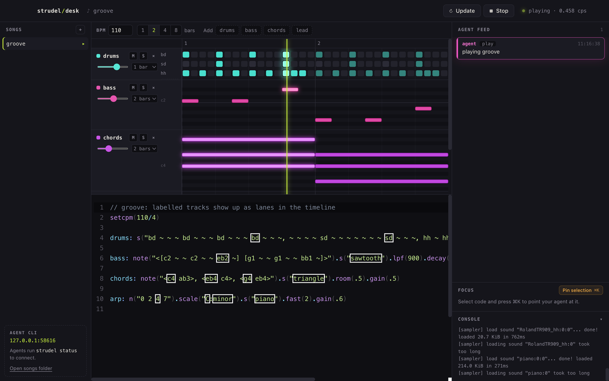

Strudel Desk puts a music-editor timeline above live code. Editing a supported step pattern in the timeline rewrites the code underneath it. A coding agent can work on the same song through the CLI, with its commands visible in a feed.

Strudel is the music engine. The work here is the desktop environment around it: the timeline, code editing, project files and the connection to agents.

## One song, two ways to edit it

Named patterns become named timeline lanes. This example comes from the project's README:

```javascript
setcpm(110/4)
drums: s("bd ~ ~ ~ bd ~ ~ ~, ~ ~ sd ~ ~ ~ sd ~, hh hh hh hh hh hh hh hh")
bass: note("<[c2 ~ eb2 ~] [g1 ~ ~ ~]>").s("sawtooth")
```

Plain step patterns support editing in the timeline. More complex mini-notation and timing transformations appear as view-only lanes, with selection still connecting a note to the code that produced it. The editor does not pretend every program can be faithfully reduced to a grid.

## Let the agent work in view

The agent uses the `strudel` CLI to change the song. Commands appear in the feed and changed lines flash with the agent's name. Selecting code and using Cmd+K, or Ctrl+K on Windows, gives the agent a specific region to work on.

The interesting interaction is listening while the song changes and being able to inspect those changes immediately. The code remains part of the instrument rather than disappearing behind an assistant chat.

## A desktop project

This is an Electron application, rather than a service running on the home server. A walkthrough can start with a simple beat, add a bass lane through the CLI, and then show timeline edits and undo. It should also show where a complex pattern becomes view-only.
