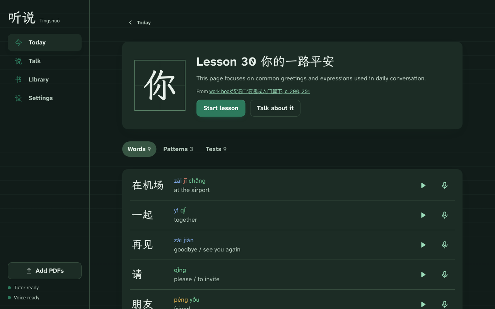

*The screenshot previews a proposed dark palette; the running app currently has a light theme.*



Tingshuo starts with the material I am actually studying. Drop in a Mandarin course PDF or class notes, let a local vision model read the pages, and turn the extracted vocabulary, patterns, texts and homework into lessons.

The next step is spoken practice: repeat the words, build sentences and work through the lesson with a tutor that answers out loud. The interface marks syllables to distinguish a good attempt from a tone or sound that needs more work.

## Give the document a structure

The server and browser share domain types. For example, the vocabulary and pattern shapes in `shared/types.ts` are small enough to show directly:

```typescript
export interface Word {
  hanzi: string;
  pinyin: string;
  english: string;
}

export interface Example {
  zh: string;
  en: string;
}

export interface Pattern {
  pattern: string;
  explanation: string;
  examples: Example[];
}
```

Those shapes connect document extraction to the lesson UI. The document is more useful when a word can become an individual practice item and a sentence pattern can be used in a guided exercise.

## Local models, separate responsibilities

The application uses a local model for page reading and tutoring, with a separate speech service for transcription, tone checking and speech output. The browser brings those results together into the lesson and practice views.

Tone feedback is assistance, not an authoritative assessment of pronunciation. A useful demonstration should include a wrong tone and a failure case, alongside a successful repetition.

## Current status

This is a personal proof of concept for one learner on a home network. It has no login. The public story is the document-to-practice workflow, not a claim that it is ready to be offered as a hosted service.
